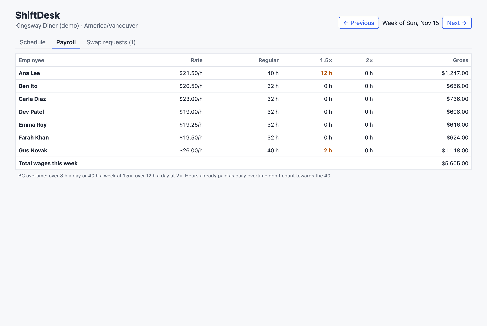

# ShiftDesk

Scheduling and payroll preview for hourly teams, the kind of tool a restaurant manager uses every
week: build the schedule, approve shift swaps, and see what the week costs before payday. A Rails
API on PostgreSQL with a React + TypeScript front end.


## What it does

- **Weekly schedule** per location (Sunday to Saturday, as BC counts weeks), with open shifts anyone
  in the role can take. Overnight shifts ("10 pm to 6 am") end the next morning.
- **Shift checks.** A shift is refused, with the reason, if the person is already working then, works
  a different role, or works at another location. A shift that is allowed but costly is saved with a
  warning: "Ana Lee would work 52.0 h this week, 12.0 h of it at overtime rates. This shift costs
  $129.00." It also warns when someone gets fewer than 8 hours off between shifts.
- **Payroll preview** under BC's Employment Standards Act: over 8 hours a day or 40 a week at 1.5×,
  over 12 hours a day at 2×. Hours already paid as daily overtime don't count towards the 40, so
  nothing is paid twice. Money is integer cents; pay rounds once, at the end.
- **Shift swaps.** An employee asks a colleague to cover; the manager approves or rejects. Approval
  re-checks everything, because the colleague may have been booked since the request was made.



## Design decisions

| Problem | What ShiftDesk does |
|---|---|
| Two managers book the same person at the same moment | Postgres refuses it: an **exclusion constraint** on `(employee_id, tsrange(starts_at, ends_at))` for live shifts. Model validations give a friendly message; the constraint is the guarantee. A test races two approvals on two database connections and only one wins, even with the model check switched off |
| Two approvals of the same swap at once | The swap and the shift are row-locked (`SELECT … FOR UPDATE`) in one transaction; a decided swap can't be decided again |
| One request per shift | A partial unique index allows only one *pending* swap per shift |
| Bad data from any client | Check constraints: shifts end after they start and last at most 16 hours; known statuses; positive pay rates |
| Cancelling a shift | Marked cancelled, not deleted, so past schedules and payroll can still be explained |
| Time zones | The server owns them. The browser sends wall-clock times at the location ("2026-11-23T09:00") and shows the local times the server returns. See below for why |

### The time zone bug the demo found

While testing, Dev's 8 am shift showed as 7 am in the browser. The time zone database on the server
(macOS, tzdata 2026f) has Vancouver staying on UTC−7 after 1 November 2026, while the browser's
copy (Node/ICU, tzdata 2026a) still switched to UTC−8. The first version converted times in the
browser, so every shift was saved and shown an hour off. Now the browser does no time zone
arithmetic: the server interprets wall-clock times with its own, updatable data and sends back
`starts_local` / `ends_local` for display. A test posts "09:00" and checks it is stored as 9 am at
the location.

## Run it

Requires Ruby 3.4+ (developed on 4.0), PostgreSQL 16 and Node 22+.

```bash
cd api
bundle install
bin/rails db:create db:migrate db:seed   # a demo diner with this week's schedule
bin/rails server                        # API on http://localhost:3000

cd ../web
npm install
npm run dev                              # http://localhost:5173 (proxies /api to Rails)
```

## API

| Method and path | Purpose |
|---|---|
| `GET /api/locations` | Locations |
| `GET /api/locations/:id/schedule?week=2026-11-25` | The week containing that date: days, employees, shifts |
| `GET /api/locations/:id/payroll?week=…` | Hours by rate and gross pay per employee |
| `POST /api/shifts` | Create a shift; returns `warnings`, or `422` with `errors` |
| `PATCH /api/shifts/:id`, `DELETE /api/shifts/:id` | Reassign or change times; cancel |
| `POST /api/shifts/:id/swap_requests` | Ask a colleague to cover (`to_employee_id`) |
| `GET /api/locations/:id/swap_requests?status=pending` | Swap requests |
| `POST /api/swap_requests/:id/approve`, `…/reject` | Decide; `409` with the reason if it can't go ahead |

## Tests

```bash
cd api && bin/rails test        # 31 tests, 81 assertions, against a real Postgres database
cd web && npx vitest run        # 12 tests
```

| Suite | What it checks |
|---|---|
| `PayrollCalculatorTest` | 8 h regular; 13 h = 8 + 4 at 1.5× + 1 at 2×; two shifts in one day; 48 h week = 40 + 8; five 10 h days = 40 + 10 (daily overtime not counted twice); overnight shifts count to the start day; rounding to the cent |
| `ShiftTest` | Length limits; role and location must match; overlaps refused with the clashing times; back-to-back, open and cancelled shifts don't clash; **the database refuses a double booking even with validations skipped** |
| `ScheduleCheckTest` | Overtime warning with the cost; under-8-hours rest warning; open shifts |
| `SwapRequestTest` | Approval moves the shift; decided once only; fails cleanly if the colleague was booked meanwhile; same role and location; one pending request per shift |
| `ConcurrentApprovalTest` | Two threads approve conflicting swaps at once on separate connections; exactly one wins |
| `ApiTest` | Week from Sunday, warnings on create, readable 422s, wall-clock times in the location zone, cancel keeps history, payroll totals, swap round trip, 404 and 400 |
| `time.test.ts` | Wall-clock times, overnight shifts across month and year ends, display formatting |
| `components.test.tsx` | The shift form sends the right payload and shows refusals and warnings; swap approvals pass warnings up and show conflicts; payroll highlights overtime |

GitHub Actions runs both suites, the linter and the production build on every push, with Postgres
16 as a service.

## Not covered

Authentication and roles (any user can act as the manager), BC's other rules (minimum daily pay,
split shifts, statutory holidays), and multiple locations in the UI. Weeks run Sunday to Saturday
and a shift counts towards the day it starts, simplifications of how BC defines a day.
